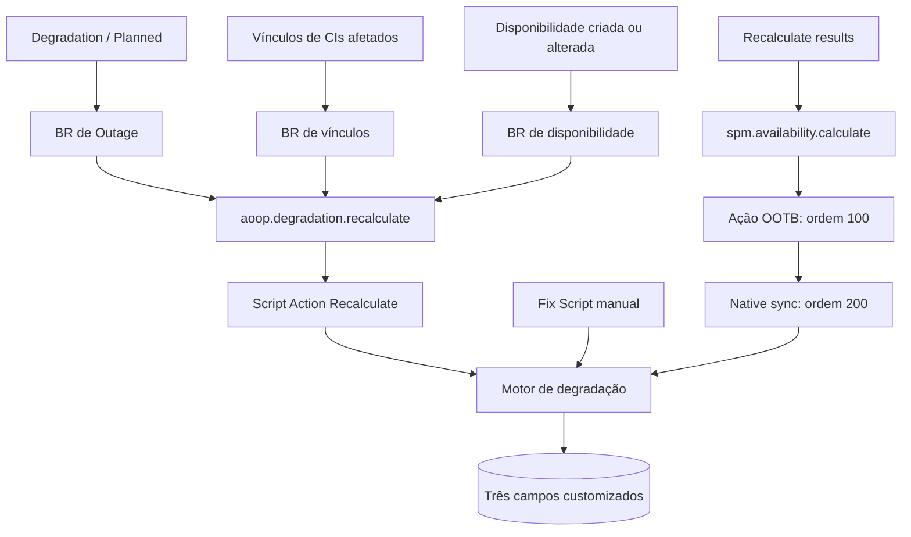

# Arquitetura

## Fluxo por eventos

A property `aoop_service_availability_calculate_degradation` é verificada na condição das três BRs, nas Script Actions e na entrada do motor. `false` impede o script das BRs de publicar eventos e bloqueia o cálculo de solicitações já enfileiradas. A condição ainda é avaliada pela plataforma.

As três BRs usam **before, ordem 900**. Capturam somente alterações relevantes e publicam solicitações. Na exclusão, essa posição preserva CI principal, datas e vínculos antes de desaparecerem. Não selecionam disponibilidades nem executam cálculos em massa; fazem as leituras de Outage e vínculos necessárias à captura.

| Origem | Mudanças relevantes |
|---|---|
| `cmdb_ci_outage` | Insert/delete; update de tipo, begin, end ou cmdb_ci; tipo anterior/atual Degradation ou Planned |
| `cmdb_outage_ci_mtom` | Insert/delete; update de outage ou ci_item; Outage referenciado Degradation ou Planned encerrado |
| `service_availability` | Insert; update de start, end, service_offering, cmdb_ci, service_commitment ou time_zone |

A BR de disponibilidade limpa somente os três resultados quando as entradas mudam. A gravação do motor usa `setWorkflow(false)` para não realimentar esse gatilho. O nativo `AvailabilityRecord` usa insert/update normais nos caminhos inspecionados, cobrindo novos períodos e avanço das janelas móveis.

## Evento e dados anteriores

O evento customizado é ancorado na property geral, um registro persistente. Não depende de conseguir carregar depois um Outage excluído.

| `parm1` | Conteúdo de `parm2` |
|---|---|
| `scope` | JSON com `ci`, `windows` de begin/end anteriores/atuais e informações da operação |
| `availability` | JSON com o `id` da disponibilidade |

A operação orienta o escopo. O consumidor sempre consulta os registros existentes, sem assumir que um evento de exclusão comprova a ausência do registro. Uma exclusão abortada tardiamente não foi homologada como cenário específico.

## Cálculo central

1. Selecionar disponibilidades existentes que intersectam os intervalos e CIs recebidos, ou carregar o registro indicado.
2. Deduplicar sys_ids de disponibilidades dentro da solicitação.
3. Buscar Degradation e Planned encerrados pelo CI principal e por `cmdb_outage_ci_mtom`.
4. Deduplicar Outages por sys_id; recortar à janela; unir sobreposições; descontar Planned.
5. Medir no modo capturado para a execução e gravar duração, percentual e contagem.

A quantidade de períodos corresponde aos trechos remanescentes após união/desconto com duração positiva. No modo por compromisso, um trecho só é contado se tiver duração elegível positiva; não é uma contagem de Outages originais.

| Modo | Numerador | Denominador |
|---|---|---|
| Absoluto | Duração líquida dos trechos degradados | Duração total da janela |
| Por compromisso | Duração dos trechos na agenda efetiva | Duração da janela na mesma agenda efetiva |

A agenda efetiva usa a agenda do compromisso e seu timezone, com fallback ao timezone da disponibilidade/UTC. Agendas de compromissos `maintenance_window` associados ao CI/Oferta são excluídas no modo por compromisso. Agenda ausente significa 24x7. Planned é descontado nos dois modos. Base zero resulta em percentual vazio.

## Deduplicação e idempotência

| Camada | Proteção |
|---|---|
| Disponibilidades | Um sys_id por processamento de evento |
| Outages | Um sys_id mesmo quando encontrado por CI principal e vínculo |
| Tempo | União dos intervalos sobrepostos antes da soma |
| Gravação | Resultado idêntico retorna `unchanged` |

Eventos separados **não são agrupados na fila**. Podem recalcular a mesma disponibilidade, mas não acumulam seus minutos.

A gravação é condicionada ao `sys_mod_count` lido, com incremento explícito e até três tentativas. A cada tentativa, o motor relê dados; não reutiliza cache de Outages entre disponibilidades. Isso não representa processamento exatamente uma vez nem teste de carga concorrente. Se as tentativas falharem, há registro em log e necessidade de reprocessamento manual.

## Recálculo nativo e mudança de modo

O botão nativo publica `spm.availability.calculate`. A Script Action OOTB de ordem 100 calcula e limpa registros de timezone antigo. A nova Script Action de ordem 200 chama nosso motor depois, sem alterar a ação nativa. Quando o evento está associado a um `service_commitment`, a sincronização customizada respeita esse compromisso; caso contrário, percorre o escopo geral.

Alterar `degradation_usecommitment` não publica evento nem limpa resultados. A rotina operacional é alterar a property e confirmar **Recalculate results**. Eventos que ocorrerem nesse intervalo já usam o novo modo; resultados antigos podem coexistir até a sincronização geral.

A execução posterior da ação 200 não comprova sucesso do OOTB, que pode capturar erros internamente. O Event Log indica consumo do evento; os logs do motor indicam resultados/erros do cálculo complementar.

## Limites

Não há Scheduled Job próprio, cursor persistente, tabela de fila customizada ou retentativa agendada de falhas. O event processor continua sendo o mecanismo assíncrono da plataforma. O Fix Script suporta recuperação manual. A sincronização geral não tem retomada persistente caso seja interrompida; pode ser repetida de forma idempotente. O desenho foi escolhido para o volume pequeno informado.
