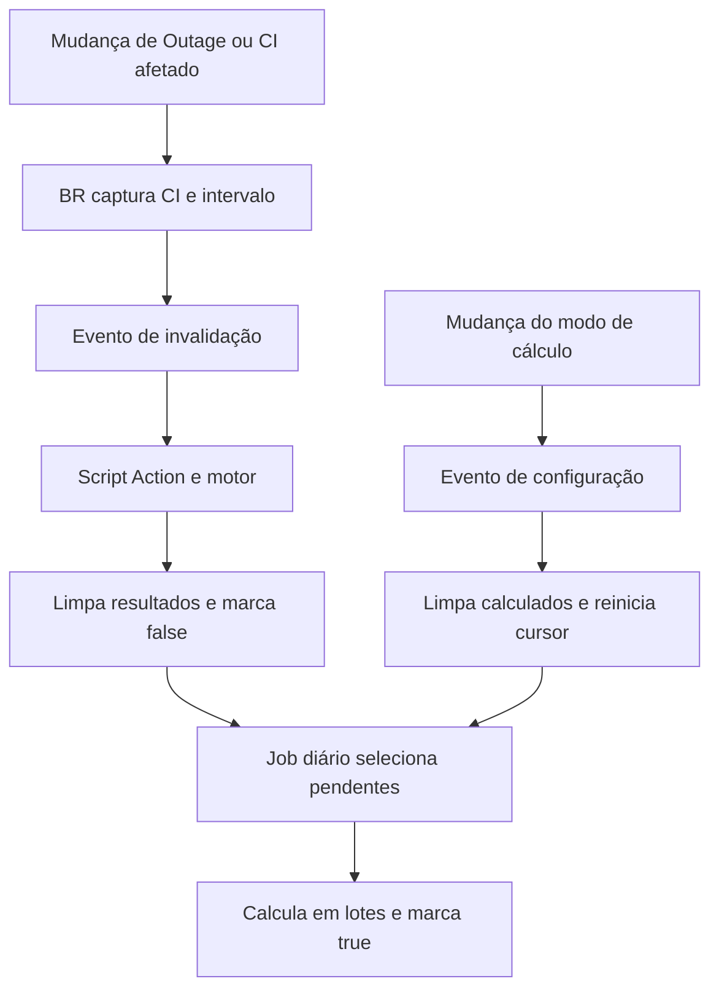

# Arquitetura e regras de cálculo

## Responsabilidades

`AOOP_ServiceAvailabilityDegradation` concentra seleção, captura de mudanças, união/subtração dos intervalos, agenda, invalidação e persistência. Os scripts OOTB não são alterados; a solução escreve apenas os quatro campos customizados e o cursor de operação.

A BR `Availability inputs` é uma exceção ao envio de evento: em `before insert/update`, limpa o próprio registro quando mudam início, fim, Oferta/CI, compromisso ou timezone. Alterações apenas nos resultados nativos não provocam essa limpeza.

## Associação e elegibilidade

O relacionamento OOTB **Outages During Interval** é referência para os caminhos de associação, não uma tabela intermediária persistida:

- Vínculo direto: `cmdb_ci_outage.cmdb_ci`.
- Vínculo de CIs afetados: `cmdb_outage_ci_mtom.outage/ci_item`.
- Ambos podem corresponder a `service_availability.service_offering` ou `cmdb_ci`.

A consulta complementar exige início/fim preenchidos e sobreposição de duração positiva: `outage.begin < availability.end` e `outage.end > availability.start`. O mesmo Outage encontrado pelos dois caminhos entra uma única vez.

A data de criação do Outage não define a apuração. São usados início/fim do evento. Um evento pode alcançar dia, semana, mês, ano, últimos 7 dias, últimos 30 dias e últimos 12 meses, desde que esses registros já existam e intersectem o evento. O motor nativo continua gerando os períodos.

## Fórmula

Para intervalo `I=[início,fim)`, seja `D` a união das degradações encerradas recortadas a `I`, e `P` a união dos planejados encerrados recortados a `I`. O intervalo líquido é `D − P`.

- `usecommitment=false`: duração = tempo de `D − P`; base = duração integral de `I`.
- `usecommitment=true`: duração = tempo elegível de `D − P` na agenda; base = tempo elegível de `I` nessa mesma agenda.
- Percentual = `100 × duração / base`. Base zero produz percentual vazio.
- Planejados são retirados do numerador; não reduzem automaticamente a base.
- Outages do tipo `outage` não entram neste cálculo complementar e não são subtraídos da degradação.
- Sobreposições e eventos contíguos de degradação são unificados antes da subtração.
- A contagem considera os fragmentos restantes de `D − P` com duração positiva. No modo de compromisso, um fragmento conta uma vez se tiver tempo elegível; lacunas da agenda não o subdividem em várias ocorrências.

A percentagem é formatada pelo código com até oito casas, mas a precisão armazenada/exibida depende da definição Decimal da instância. O nome técnico `u_absolute_degradation` é mantido também no modo por compromisso.

## Agenda e timezone

O motor carrega o compromisso do registro, usa seu timezone ou o timezone da disponibilidade como fallback, e considera os compromissos de manutenção associados à Oferta/CI. Sem agenda de disponibilidade, considera tempo integral, com as exclusões de manutenção aplicáveis.

Usa `GlideSchedule.duration()` e, para manutenção, `addOtherSchedule0(..., false)`, como o código nativo consultado na origem. Essa última chamada é dependente da versão da plataforma e deve ser validada no destino.

## Invalidação

A invalidação limpa duração, percentual e contagem e marca o ponteiro `false`. Não calcula.

A captura guarda intervalos e CIs anteriores/atuais para atingir tanto o que passou a ser afetado quanto o que deixou de ser afetado. Exclusões são capturadas em `before`. Os eventos de Outage usam a property habilitadora como referência persistente, evitando dependência de registros já excluídos.

Se a última degradação desaparecer, os valores anteriores são limpos. Sem outra degradação encerrada, o registro permanece `false`, fora do cálculo. Zeros são resultados válidos de uma degradação inteiramente excluída por planejados ou agenda. Um Duration vazio pode aparecer como “0 Seconds” na interface; o ponteiro distingue validade.

## Lotes e cursor

Não existem pacotes persistidos. A cada `run()`:

1. Consulta degradações encerradas, ordenadas por `sys_id`.
2. Quando há cursor, inclui `sys_id >= cursor`.
3. Para cada CI afetado, consulta disponibilidades sobrepostas e `false`.
4. Deduplica candidatos dentro do lote.
5. Calcula até o limite de tentativas ou orçamento de tempo.
6. Persiste o `sys_id` do Outage atual como cursor se precisar continuar.

O Outage do cursor é revisitado. As disponibilidades já concluídas ficam de fora pelo filtro `false`. Ao concluir o percurso, o cursor fica vazio.

O job encadeia lotes até concluir o percurso, ocorrer erro ou atingir 500 lotes/orçamento de 600.000 ms. Cada `run()` tem limite próprio de 100 tentativas e 30.000 ms, configurável por properties. Os tempos são verificados entre processamentos; uma consulta ou cálculo individual pode ultrapassá-los.

Em interrupção antes de salvar o cursor, a retomada pode repetir seleção; os `true` continuam excluídos. Falhas mantêm o registro pendente e são registradas em log. Uma falha anterior ao cursor pode aguardar o próximo ciclo completo. Não há fila de falhas independente.

## Concorrência

A atualização final filtra por `sys_id`, ponteiro `false` e `sys_mod_count` lido inicialmente. Uma atualização que incremente esse contador impede a gravação antiga. Não há campo próprio de revisão. O contador não cobre operações que suprimam seus campos de sistema.

## Custo de seleção

Mesmo sem pendências, um novo ciclo volta a percorrer as degradações encerradas e consultar disponibilidades correspondentes. O código não itera sobre todas as disponibilidades apenas por estarem `false`, mas isso não garante um plano SQL sem full scan. Intervalos anuais podem carregar muitos eventos do mesmo CI em um único cálculo. O teste de 100 Outages não representa uma homologação para 25.000 eventos.

